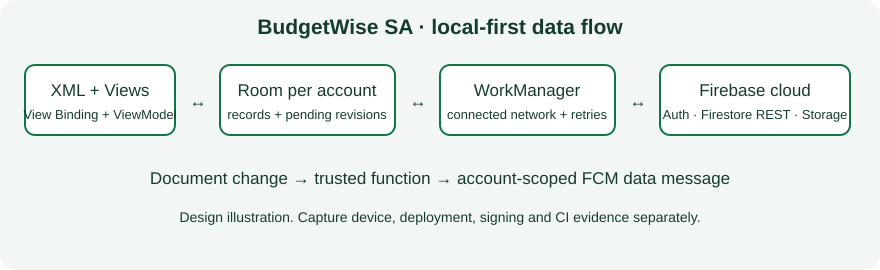

# BudgetWise SA

[](https://github.com/Faranani-Netshirando/Budgetwise-part-3/actions/workflows/android.yml)


BudgetWise SA is a Kotlin Android app for recording rand income and expenses, planning budgets and tracking savings goals. XML layouts, Android Views and View Binding provide the interface, Room stores local data, and Firebase supplies authentication, Firestore, receipt storage and push delivery.

**Final PoE candidate:** source and submission preparation have been revised. A physical-phone demonstration, live Firebase verification, an owner-signed release and a successful GitHub Actions run are still required. See the [assessment audit](docs/ASSESSMENT_AUDIT.md) and [actual verification results](docs/VERIFICATION.md).

## Features

- **Authentication:** email/password, Google SSO and the existing phone/SMS flow through Firebase. Forms validate inputs. Passwords go directly to Firebase over TLS and are not saved in Room, preferences or logs; Firebase handles password hashing.
- **Transactions:** add/edit/delete, search, income/expense filters, date picker, receipt attachment/viewing/export.
- **Budgets:** weekly (Monday–Sunday), monthly and yearly calendar periods. Spending is calculated from expenses, so edits, category/date changes and deletions update the total. Saved thresholds control alerts.
- **Savings and reports:** named goals, editable deadlines, progress, category charts and income/expense totals. Badges now depend on recorded activity and achieved goals.
- **Persistent settings:** theme, alert threshold, notification opt-in and language. UI resources support **English, Tshivenda and isiZulu**; fluent-speaker review is still needed.
- **Offline work:** Room saves records and deletion tombstones. WorkManager waits for connectivity, retries transient failures, and requests periodic reconciliation. Settings shows pending changes and sync work status.
- **Account isolation:** each Firebase UID has a separate local database; local guest mode is separate again. Guest records never silently upload to an account. Sign out clears the visible session, while signing into the same account restores its local data.
- **REST and NoSQL:** Retrofit calls Firestore's actual authenticated REST GET/PATCH endpoints, including paginated reads. The unused Render endpoint has been removed.
- **Blob storage:** original-device receipt copies remain in private storage. Sync uploads receipt images to Firebase Storage before uploading their document. Other devices receive a cloud URL and need connectivity for the first image load.
- **Push:** FCM service, channel, Android 13+ permission, opt-in, token registration and account filtering. A supplied trusted Cloud Function sends account-scoped data messages when financial documents change; actual push requires deployment.
- **Artwork:** wallet/rand launcher replaces the starter robot. Documentation illustrations are design assets, not phone screenshots.

## Design report



Android Views observe MainViewModel through lifecycle-aware collectors and View Binding. RecyclerView displays financial records, Material dialogs edit records, and a native Canvas View draws spending charts. The account-scoped BudgetRepository uses Room. A network-constrained SyncWorker uploads pending revisions through Firestore REST after any receipt upload, then reconciles cloud data into Room.

Jetpack Compose has been removed from the source, compiler plugins and dependencies. View Binding generates references from the XML layouts under app/src/main/res/layout/.

Each record has a stable UUID and revision. Acknowledgements mark only the revision actually uploaded, so edits made during a request remain pending. Deletes stay as hidden tombstones so disconnected devices can learn about them. Cloud pulls run in a database transaction and preserve pending local changes.

**Conflict policy:** the last successful server write wins for concurrent edits to the same record. There is no field-level merge. Tombstones and old receipt versions are retained; production retention, cleanup and full account deletion still need completion before public publication. Financial values retain the prototype's Double representation with bounded finite validation; this app does not execute payments.

The prototype's unowned local database is preserved under its old filename instead of being assigned to an arbitrary account. Revised accounts use new files. Surviving legacy Firestore documents receive default sync metadata on read; data already overwritten by the prototype cannot be recovered without backups.

WorkManager may be delayed by Android background restrictions. Reopening the app or using Sync now requests another attempt. Authentication and initial cloud-image retrieval need connectivity; financial CRUD works offline after sign-in. Guest mode stores data locally only.

## Setup and build

Use **JDK 17**, **SDK 36**, **Build Tools 35.0.0**, and Android 8.0/API 26 or later. AGP 8.10.1 and Gradle 8.11.1 are pinned.

1. Open the root in Android Studio and select JDK 17.
2. Put the team's Firebase Android configuration in `app/google-services.json`. The existing local file is retained and ignored by Git.
3. Follow [Firebase setup](docs/SETUP.md) for providers, signing fingerprints, rules, Storage and the push function.
4. Configure the SDK in Android Studio or ignored `local.properties`.
5. Run:

```powershell
.\gradlew.bat testDebugUnitTest lintDebug assembleDebug assembleDebugAndroidTest
.\gradlew.bat connectedDebugAndroidTest
```

The second command requires a connected, authorized device or emulator. Debug APK: `app/build/outputs/apk/debug/app-debug.apk`. The build-only fixture `app/google-services.example.json` can be copied to `google-services.json` for compilation and guest mode; it cannot connect to real Firebase.

On this Windows checkout, `./scripts/verify.ps1` automatically selects the task-local JDK/SDK when present and reruns the local build checks.

See [publishing preparation](docs/PUBLISHING.md) for owner-key release signing. Never commit keys/passwords.

## Automated checks and GitHub

[Android checks](.github/workflows/android.yml) runs JVM tests, lint, debug/test-APK builds, emulator instrumentation, backend push tests and Firestore/Storage rule tests, then uploads reports/APKs.

Tests cover invalid inputs, South African calendar boundaries, edit/delete recalculation, stable IDs, REST encoding, offline durability, stale acknowledgements, account separation, native layout/chart rendering in light and dark modes, navigation/form controls, push batching and rule ownership. CI uses a fake Firebase configuration: successful CI does not prove live SSO, cloud uploads or push. Actual results belong in [VERIFICATION.md](docs/VERIFICATION.md).

The project repository is [Faranani-Netshirando/Budgetwise-part-3](https://github.com/Faranani-Netshirando/Budgetwise-part-3). The source, documentation and workflow are prepared for its main branch. Check [GitHub Actions](https://github.com/Faranani-Netshirando/Budgetwise-part-3/actions/workflows/android.yml) for hosted results; local test results are recorded separately. Create the final PoE tag only after the remaining demonstration, cloud verification and release evidence are complete.

## Portfolio of Evidence

Developers, as named in the supplied project:

- FARANANI NETSHIRANDO (ST10443627)
- NDIVHUWO RANKHODODO (ST10442256)
- REVELE VELE (ST10446018)
- MAREMA PHATHUTSHEDZO (ST10442530)

[Release notes](RELEASE_NOTES.md) explain changes from the supplied prototype. The [narrated demo script](docs/DEMO_SCRIPT.md) lists the physical-phone and console evidence. The under-500-word [AI-use disclosure](docs/AI_USE.md) is a team-review draft.

Existing prototype links: [YouTube](https://youtu.be/bIFmsnv2Nw8), [TikTok](https://vt.tiktok.com/ZSbJkqnXF/). Their content has not been verified against this revision. Record a new narrated demonstration on a physical Android phone and update the link. Save real screenshots under `docs/evidence/` and embed selected captures here. The design artwork above is not runtime evidence.

## References

- [Android View Binding](https://developer.android.com/topic/libraries/view-binding)
- [Material Components for Android Views](https://github.com/material-components/material-components-android/blob/master/docs/getting-started.md)
- [Firebase email/password authentication](https://firebase.google.com/docs/auth/android/password-auth)
- [Firebase Google authentication](https://firebase.google.com/docs/auth/android/google-signin)
- [Firestore REST API/user-token authorization](https://firebase.google.com/docs/firestore/use-rest-api)
- [Firestore security rules](https://firebase.google.com/docs/firestore/security/get-started)
- [Storage security](https://firebase.google.com/docs/storage/security)
- [WorkManager](https://developer.android.com/develop/background-work/background-tasks/persistent)
- [FCM Android](https://firebase.google.com/docs/cloud-messaging/android/receive-messages)
- [Firestore functions](https://firebase.google.com/docs/functions/firestore-events)
- [FCM Admin SDK](https://firebase.google.com/docs/cloud-messaging/send/admin-sdk)
- [AGP 8.10 compatibility](https://developer.android.com/build/releases/agp-8-10-0-release-notes)
- [App signing](https://developer.android.com/studio/publish/app-signing)
- [Play target API requirements](https://support.google.com/googleplay/android-developer/answer/11926878)


## Project Demonstration Video

YouTube link: 
https://youtu.be/0l6O-5xBpiQ?si=O7ztxDKE2vj-EKxv
